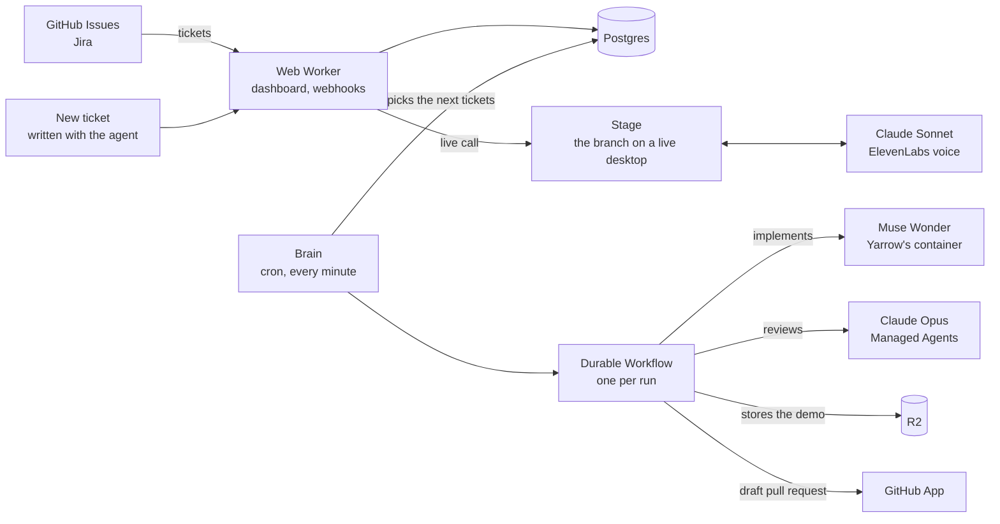

<p align="center">
  <a href="https://yarrow.run">
    <picture>
      <source media="(prefers-color-scheme: dark)" srcset="public/brand/yarrow-logo-on-dark.svg">
      
    </picture>
  </a>
</p>

<h3 align="center">The best ticket harness for your product team</h3>

<p align="center">
  Coding is solved. Writing the right ticket and reviewing what agents ship are not.
</p>

<p align="center">
  <a href="https://yarrow.run">Website</a> ·
  <a href="#how-it-works">How it works</a> ·
  <a href="#getting-started">Getting started</a> ·
  <a href="#deployment">Deployment</a>
</p>

<p align="center">
  <a href="https://github.com/KevTale/yarrow/actions/workflows/deploy.yml"></a>
</p>

Yarrow helps you shape an idea into a clear ticket. Once agents have built it, it walks you through a live demo of the result and answers your questions.

## What it does

1. **Write the ticket with an agent.** In writing or on a call, it reads the repository and the project's tickets, says what already exists and asks what it cannot find out alone. Tickets can also come from GitHub Issues or Jira.
2. **Agents build it.** One model implements and a model from another lab reviews. The outcome is a draft pull request, or a stated reason for stopping.
3. **Watch the demo.** Every pull request comes with a narrated demo recorded on a real desktop: the app running, the code in a real VS Code, the commands in a terminal. It goes from the context to the change to the proof.
4. **Ask anything.** Speak or type and the demo stops. The agent answers aloud on a live desktop running the branch, where it can click through the app, open files and run the tests in front of you.
5. **Merge, or ask for a change.** From Yarrow, or by commenting `@yarrow-run` on the pull request.

## How it works



The brain runs every minute. Tickets start first in, first out within an account and round-robin between accounts, and each run is one durable Workflow. Tracker tickets are synced every five minutes.

A run is never reviewed by the lab that wrote it:

| Work                              | Model                                     | Where it runs                                     |
| --------------------------------- | ----------------------------------------- | ------------------------------------------------- |
| Implementation                    | Muse Wonder                               | Yarrow's own container, with no API key inside it |
| Code review                       | Claude Opus                               | Claude Managed Agents                             |
| Chat, live calls, writing tickets | Claude Sonnet                             | Claude API, with ElevenLabs for the voice         |
| Projects with secrets             | Claude Opus implements, GPT Astra reviews | Claude Managed Agents and the OpenAI Agents API   |

Models are server-side configuration (`IMPLEMENTER`, `META_MODEL`, `META_EFFORT`, `TALK_MODEL`, `OPENAI_REVIEW_MODEL` in `workers/wrangler.jsonc`).

## Project structure

| Path                  | What it is                                                                             |
| --------------------- | -------------------------------------------------------------------------------------- |
| `src/routes/`         | Pages and endpoints, on TanStack Start and Cloudflare Workers                          |
| `src/functions/`      | Server functions called by the pages                                                   |
| `src/core/`           | Shared rules with no I/O: queue, contracts. Runs in every Worker                       |
| `src/db/`, `drizzle/` | Drizzle schema and SQL migrations                                                      |
| `src/server/`         | Auth, the GitHub App, Jira, Linear and Trello                                          |
| `src/runner/`         | Agent clients, prompts, the recorder behind the demos, the voice                       |
| `workers/brain.ts`    | Cron dispatcher and the per-run Workflow                                               |
| `workers/muse.ts`     | The container Muse Wonder works in (`workers/muse/Dockerfile`)                         |
| `workers/stage.ts`    | The live desktop behind a call, on the same image                                      |
| `workers/admin.ts`    | Internal admin behind Cloudflare Access. It holds no secret and goes through the brain |
| `bench/`              | Live test bench: six small apps and the tickets Yarrow must solve on them              |
| `tests/`              | Unit tests on real SQL through PGlite, end-to-end tests with Playwright                |
| `video/`              | Promo films in Remotion, a pnpm workspace of their own                                 |

## Getting started

You need [Node.js](https://nodejs.org) 22 or later and pnpm, which Corepack provides.

```bash
git clone https://github.com/KevTale/yarrow.git
cd yarrow
corepack enable
pnpm install
pnpm dev
```

The app runs on [localhost:3000](http://localhost:3000). No secret is needed for the interface: without a database the public pages show their empty state, and each integration answers "not configured".

On Windows, clone with `git -c core.longpaths=true clone` if the path to your folder is long.

### Running it on your own services

```bash
cp .dev.vars.example .dev.vars
cp workers/.dev.vars.example workers/.dev.vars
cp .env.example .env
```

1. Fill in what you need, with test values only. A missing secret turns off that feature and nothing else.
2. Point `SUPABASE_URL`, `SUPABASE_PUBLISHABLE_KEY` and `GITHUB_APP_SLUG` in `wrangler.jsonc` at your own Supabase project and GitHub App. The committed values belong to Yarrow's development environment.
3. Apply the migrations with `pnpm db:migrate`, which reads `DATABASE_URL` from your shell or from `.env`.
4. Run `pnpm dev` for the web app and `pnpm brain:dev` for the brain.

Muse Wonder and the live stage run in Cloudflare Containers, on a deployed environment only. A brain running locally implements with Claude.

## Configuration

Secrets of the web Worker go in `.dev.vars`, those of the brain in `workers/.dev.vars`. Public values live in `wrangler.jsonc` and `workers/wrangler.jsonc`.

| Variable                                                    | Worker     | Used for                                             |
| ----------------------------------------------------------- | ---------- | ---------------------------------------------------- |
| `DATABASE_URL`                                              | web, brain | Postgres, through the transaction pooler             |
| `GITHUB_APP_ID`, `GITHUB_APP_PRIVATE_KEY`                   | web, brain | The GitHub App                                       |
| `GITHUB_APP_WEBHOOK_SECRET`                                 | web        | Verifying GitHub webhooks                            |
| `TOKEN_ENCRYPTION_KEY`                                      | web, brain | Encrypting tracker tokens, 32 random bytes in base64 |
| `META_API_KEY`                                              | brain      | Muse Wonder and Muse Spark                           |
| `ANTHROPIC_API_KEY`                                         | web, brain | Reviews, projects with secrets, their vaults         |
| `ANTHROPIC_AGENT_ID`, `ANTHROPIC_ENVIRONMENT_ID`            | brain      | Printed by `pnpm bootstrap:anthropic`                |
| `OPENAI_API_KEY`                                            | brain      | Reviews on projects with secrets                     |
| `ELEVENLABS_API_KEY`, `ELEVENLABS_AGENT_ID`, `VOICE_SECRET` | brain      | Live calls, set up by `pnpm voice:agent`             |
| `JIRA_CLIENT_ID`, `JIRA_CLIENT_SECRET`                      | web, brain | Jira OAuth                                           |
| `LINEAR_CLIENT_ID`, `LINEAR_CLIENT_SECRET`                  | web, brain | Linear OAuth                                         |
| `LINEAR_WEBHOOK_SECRET`                                     | web        | Verifying Linear webhooks                            |
| `TRELLO_API_KEY`, `TRELLO_API_SECRET`                       | web, brain | Trello                                               |
| `RESEND_API_KEY`                                            | web, brain | Emails and alerts                                    |
| `SUPABASE_SECRET_KEY`                                       | web        | Account deletion, email changes, sign-in links       |

## Development

| Command                           | What it does                                                          |
| --------------------------------- | --------------------------------------------------------------------- |
| `pnpm dev`                        | Web app on port 3000                                                  |
| `pnpm brain:dev`                  | The brain Worker                                                      |
| `pnpm admin:dev`                  | The admin Worker on port 8788                                         |
| `pnpm check`                      | Lint, typecheck for the web app and the brain, unit tests, build      |
| `pnpm test:e2e`                   | Playwright on desktop and mobile, on the production build             |
| `pnpm brain:check`                | Bundles the brain without deploying it                                |
| `pnpm db:generate`                | New Drizzle migration after editing `src/db/schema.ts`                |
| `pnpm db:migrate`                 | Applies the migrations                                                |
| `pnpm recorder:embed`             | Embeds the recorder after editing `src/runner/recorder/present.mjs`   |
| `pnpm bench <scenario\|app\|all>` | Real tickets on the bench repositories, answered by a deployed Yarrow |
| `pnpm bench:talk`                 | The same spoken questions asked of each model on a pull request       |
| `pnpm --dir video studio`         | Previews the promo film, after `pnpm install` inside `video/`         |

### Testing

`pnpm check` runs without any secret or remote service. Unit tests apply the real migrations on PGlite and run real SQL, with provider APIs mocked from their documentation. End-to-end tests need a browser and a build first:

```bash
pnpm build
pnpm exec playwright install chromium
pnpm test:e2e
```

The bench is the live check. Each app in `bench/apps/` is pushed to a repository of its own, and `bench/scenarios.ts` holds the tickets and what Yarrow must make of them. Run it after changing what the agents do or deliver. Each scenario costs what a real ticket costs.

## Deployment

Two branches deploy to two environments through [`deploy.yml`](.github/workflows/deploy.yml), which runs lint, typecheck and tests before `pnpm deploy:dev` or `pnpm deploy:prod`:

| Environment | Branch | Address          | Database and GitHub App |
| ----------- | ------ | ---------------- | ----------------------- |
| Local       |        | `localhost:3000` | Shared with development |
| Development | `main` | `dev.yarrow.run` | Its own                 |
| Production  | `prod` | `yarrow.run`     | Its own                 |

The workflow needs one repository secret, `CLOUDFLARE_API_TOKEN`. The worker names, routes and account in `wrangler.jsonc`, `workers/wrangler.jsonc`, `workers/admin.wrangler.jsonc` and `deploy.yml` are Yarrow's: replace them to deploy your own. To stop new runs without redeploying, set `DISPATCH=off` on the brain.

Each secret is set once per environment:

```bash
pnpm exec wrangler secret put NAME --env dev                                 # web
pnpm exec wrangler secret put NAME --config workers/wrangler.jsonc --env dev # brain
```

### Setting up an environment

`<APP_URL>` is the address of the environment.

1. **Database.** Create a Supabase project, apply the migrations and set `DATABASE_URL` on both Workers.
2. **Sign-in.** In Supabase Auth, enable the GitHub provider with the client ID and secret of the GitHub App below. Set the site URL to `<APP_URL>`, the redirect to `<APP_URL>/**` and the email OTP expiry to 86400 seconds.
3. **GitHub App.** Make it installable by any account.
   - Repository permissions: Contents, Pull requests and Issues in write, Metadata in read. Account permission: Email addresses in read.
   - Events: Installation, Installation repositories, Issues, Issue comment, Pull request, Repository.
   - Webhook: `<APP_URL>/api/webhooks/github`.
   - Callback URL: `https://<supabase-ref>.supabase.co/auth/v1/callback`. Setup URL: `<APP_URL>/connect/done`, with "Redirect on update" on.
4. **Providers.** Use platform API keys from Meta, Anthropic and OpenAI, never a consumer subscription. `pnpm bootstrap:anthropic` creates the Claude agent and its environment. Turn on automatic top-up with a monthly limit on each console: when an account runs dry, tickets wait in the queue and the brain sends an alert through Resend.
5. **Voice.** With `ELEVENLABS_API_KEY` set, `pnpm voice:agent` creates or updates the ElevenLabs agent and sets its secrets on the brain. It also needs `CLOUDFLARE_API_TOKEN`.
6. **Trackers** (optional).
   - Jira: create an OAuth 2.0 integration on [developer.atlassian.com](https://developer.atlassian.com/console/myapps/) with the `read:jira-work` and `write:jira-work` scopes, the callback `<APP_URL>/integrations/jira/callback`, and sharing turned on.
   - Linear: create a public application on [linear.app](https://linear.app/settings/api/applications/new) with the callback `<APP_URL>/integrations/linear/callback` and a webhook on `<APP_URL>/api/webhooks/linear` for Issues.
   - Trello: create a Power-Up and its API key on [trello.com](https://trello.com/power-ups/admin), with `<APP_URL>` in the key's allowed origins. Trello returns to `<APP_URL>/integrations/trello-callback`.
7. **Storage.** Create the R2 buckets named in the two Wrangler files. Both Workers bind them as `EVIDENCE`.
8. **Secrets.** Set them on both Workers, then push to the environment's branch.

## Security model

- **Platform API keys only.** No Claude, ChatGPT or other consumer subscription is used, stored or triggered.
- **No project secrets.** Yarrow stores references to the provider's vault, never the values.
- **One way to write to GitHub.** Only the brain writes, through the GitHub App. Sandboxes get read-only tokens.
- **A database the browser cannot reach.** Every table has row level security with no policy, and queries are server-side only.

## Documentation

- [`docs/mvp/BUILD.md`](docs/mvp/BUILD.md) is the source of truth for product decisions and why they were made.
- [`AGENTS.md`](AGENTS.md) gives the stack, commands and rules, for contributors and coding agents.

## License

Yarrow is free software under the [GNU Affero General Public License v3.0](LICENSE). If you run a modified version as a service, you must offer its source code to its users.
