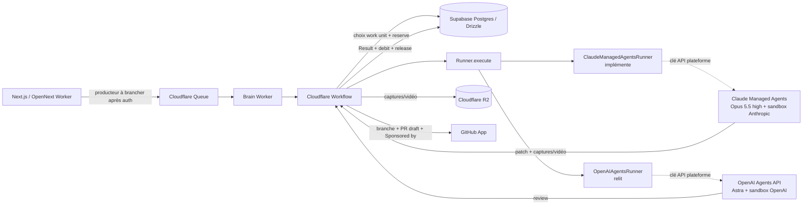
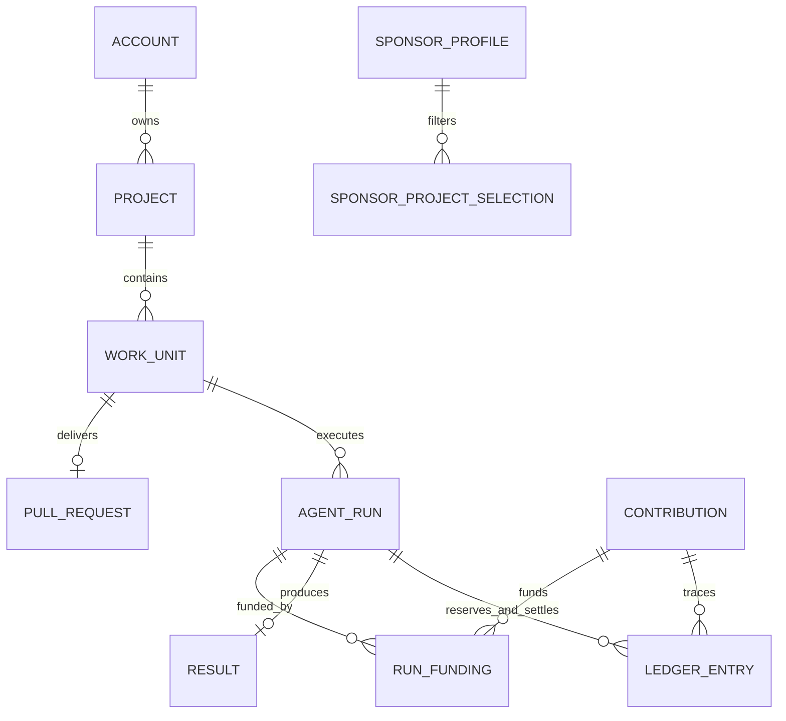

# Architecture

Les décisions de [BUILD.md](mvp/BUILD.md) priment sur les propositions historiques de la synthèse. Ce document décrit l'architecture **cible**. Les points où le code diffère encore sont signalés par **[actuel]**.

## Frontières

- **Boutique :** App Router, UI, futures sessions Supabase Auth, checkout Stripe et webhooks. `wrangler.jsonc` déclare le Worker OpenNext et le binding producteur `WORK_QUEUE`. Les routes de démonstration ne publient aucun message.
- **Cerveau :** `workers/brain.ts` consomme les messages et crée une instance Workflow avec un `runId` stable. Le Workflow :
  - choisit la work unit ;
  - réserve le budget ;
  - fait implémenter le ticket par Claude, puis relire par OpenAI ;
  - ouvre la PR ;
  - enregistre le résultat et libère le reste.

  Les messages invalides épuisent les retries avant la dead-letter queue. Aucun endpoint HTTP public ne déclenche un run.

- **Atelier :** la plateforme n'héberge **aucun** environnement d'exécution.
  - Chaque adaptateur démarre une session chez le fournisseur avec la clé API de la plateforme :
    - Claude Managed Agents (bêta, harness Claude Code) ;
    - OpenAI Agents API (bêta, harness Codex), avec une sandbox hébergée par chaque fournisseur.
  - La session reçoit :
    - le ticket ;
    - un jeton GitHub App **en lecture seule**, éphémère et limité au repo du run ;
    - la configuration de lancement du projet ;
    - les secrets de test, via le vault du fournisseur : l'agent ne voit jamais les valeurs.
  - Elle renvoie un patch, un résumé, des captures et une vidéo quand c'est pertinent, ou bien une abstention motivée.
  - **[actuel]** Seul `src/runner/cloudflare-sandbox-runner.ts` existe : un stub qui s'abstient (`sandbox_not_configured`) à coût nul, sans appel réseau ni LLM.
- **Livraison :** seul le cerveau écrit sur GitHub, via la GitHub App installée par le porteur de projet. Il crée la branche, le commit et une **PR draft**. Le corps de la PR se termine par :
  `Sponsored by <sponsors> via [Agent Commons](<URL du run>)`.

  Les noms viennent des contributions qui ont financé le run. Un sponsor anonyme apparaît comme « an anonymous sponsor ». Pour Jira, le cerveau commente le ticket avec le lien de la PR.

- **Fournisseurs :** uniquement des comptes **API** de la plateforme (Anthropic Console, OpenAI Platform), crédités avec l'argent des sponsors.
  - Jamais d'abonnement grand public, ni celui de la plateforme ni celui des sponsors.
  - La plateforme ne détient ni ne déclenche jamais d'identifiants claude.ai ou ChatGPT.
  - Le produit n'utilise pas les noms « Claude Code » ou « Codex » comme marque.

## Choix du travail

- **Rotation gratuite :** elle se fait **par compte (organisation)**, pas par projet. À chaque cycle, on prend le compte éligible servi le moins récemment, puis son plus ancien ticket autorisé : label `agent-commons` sur GitHub, ou l'équivalent dans Linear, Jira ou Trello.
- **Rôles fixes :** Opus 5.5 (effort élevé) implémente, Astra relit, systématiquement. Les modèles sont configurés côté serveur.
- **Pipeline :**
  1. contrôle des règles d'usage ;
  2. implémentation, tests et lint. Si Opus juge le ticket flou, Astra le relit : s'il le juge flou lui aussi, un commentaire demande des précisions sur le ticket, et le run se termine en abstention `ticket_unclear` ;
  3. review par Astra, puis **un tour de correction** par Opus ;
  4. captures et vidéo si le changement est visible et que l'app peut tourner ;
  5. une seule PR, lisible en deux minutes, ou une abstention.
- **Contributions :** une contribution ne peut financer un run que si le projet est dans le périmètre du sponsor :
  - en mode `all_except`, tous les projets sauf les catégories et projets exclus ;
  - en mode `only`, uniquement les projets cochés.

  Les projets cachés sont exclus, sauf si le sponsor les a explicitement acceptés. Un sponsor sans profil suit les réglages par défaut : `all_except`, sans projets cachés. Les stacks ciblées, si le sponsor en a choisi, doivent croiser celles du projet.

  **[actuel]** La base est alignée. Les formulaires et l'UI de démonstration utilisent encore `commons` / `commercial`.

## Deux modes du Workflow

Sans `DATABASE_URL`, une étape durable renvoie `{ mode: "stub", ledger: "not_connected", result }`. Aucune réservation fictive n'est présentée comme persistée.

Avec `DATABASE_URL`, il faut que des projets, des contributions réglées et des work units autorisées existent déjà. Le Workflow utilise alors le vrai ledger PostgreSQL avant et après le runner. Avec le stub actuel, une réservation de 800 cents est suivie d'un débit de 0 et d'une libération de 800 cents. Ne pas renseigner une base de production pour cette démonstration.

## Ledger

- **Montants et crédit**
  - USD uniquement, montants entiers en cents. `available = credit - reserved - debited`.
  - Crédit d'une contribution = montant payé HT − frais Stripe réels (lus dans la balance transaction du webhook) − 10 % de marge sur le montant HT.
  - TVA via Stripe Tax : prix TTC pour les particuliers de l'UE, autoliquidation pour les entreprises de l'UE ayant un numéro de TVA.
  - Packs de $10, $25 et $100, ou montant libre entre $10 et $1 000. **[actuel]** Packs $5 / $20 / $100, sans montant libre.
- **Coût d'un run :** tokens + temps de sandbox ou de conteneur, d'après les données d'usage du fournisseur, converti en cents.
- **Réservation atomique :**
  - verrou de la work unit, puis des contributions éligibles ;
  - contrôles : autorisation, projet non suspendu, statut de la work unit (`queued` pour une implémentation, `delivered` pour une correction) et périmètre du sponsor ;
  - un run peut être financé par **plusieurs contributions**, l'argent le plus ancien d'abord (`run_fundings`) ;
  - le budget initial est une estimation, **pas un plafond**. `reserveMore` ajoute des réservations en cours de run, numérotées pour ne jamais réserver deux fois ;
  - à la clôture, le coût réel au-delà de toutes les réservations est enregistré en `uncoveredCents`, absorbé par la plateforme.
- **Idempotence :** le `runId` et les clés d'idempotence des écritures empêchent un second débit après une redélivrance. Un résultat différent pour un run déjà réglé est rejeté.
- **Résultats :**
  - Un résultat contient soit une URL de PR et des preuves, soit un motif d'abstention codifié (`ticket_unclear`, `policy_violation`, `provider_error`…).
  - Une abstention consomme le compute réellement utilisé.
  - La clôture écrit `debit` et `release` pour chaque contribution, dans la même transaction.
  - Une work unit a **une seule PR**. Les corrections mettent à jour la même PR. Le merge ou le refus (avec sa raison) est enregistré pour les métriques.
- **Réservations :** `reservedCents` sur un run conserve le total réservé pour l'audit. Sur une contribution, il ne représente que les réservations encore ouvertes.
- **Événements :** chaque action du ledger écrit un événement (`run.started`, `run.reserved_more`, `run.finished`, `pull_request.merged`, `pull_request.closed`) dans la même transaction.
- **Leaderboard :**
  - Classé par **compute consommé** (somme des débits).
  - Exclus : crédits promo, remboursements et sponsors anonymes.
  - Le crédit payé mais non consommé est affiché comme « committed », sans compter dans le rang.
  - Les PR mergées sont une métrique distincte.
  - **[actuel]** La requête `sponsorLeaderboard` est alignée. L'UI affiche encore des fixtures signalées comme exemples.
- **Accès :** RLS activée sur toutes les tables, sans policy publique dans le scaffold. Seule une connexion serveur disposant des permissions requises peut les utiliser. Pas d'accès direct depuis le navigateur.

## Avant d'activer du travail payant

1. Supabase Auth, contrôles de propriété des ressources et identité stable pour le leaderboard.
2. Stripe :
   - prix et montant libre validés côté serveur ;
   - checkout authentifié ;
   - webhooks signés et dédupliqués ;
   - écriture `credit` transactionnelle à partir des frais réels ;
   - politique de remboursement.

   Un retour de checkout n'est jamais une preuve de paiement.

3. GitHub App à permissions limitées : jetons en lecture seule pour les sessions, écriture réservée au cerveau, et vérification des labels. Jira OAuth sur un site dédié, avec validation de l'autorisation des tickets et lien vers la PR.
4. Producteur Queue après un intake autorisé, avec outbox transactionnelle ou réconciliation, pour ne pas perdre de message entre Postgres et Queue.
5. Adaptateurs Managed Agents et Agents API :
   - plafond de durée et de coût par session, et arrêt effectif ;
   - mesure du coût réel ;
   - exécution des tests ;
   - dossier de preuve.
6. Idempotence durable de l'exécution et réconciliation des runs interrompus.
   - Les retries du step d'exécution sont à zéro en attendant.
   - Une erreur après réservation conserve celle-ci pour réconciliation : ne pas libérer aveuglément un montant dont le coût réel est inconnu.

## Références techniques

- [OpenNext pour Cloudflare : configuration](https://opennext.js.org/cloudflare/get-started)
- [Cloudflare Workflows : API Workers](https://developers.cloudflare.com/workflows/build/workers-api/)
- [Claude Managed Agents](https://platform.claude.com/docs/en/managed-agents/overview)
- [OpenAI Agents API](https://developers.openai.com/api/docs/guides/agents-api/overview)
- [Claude Code : conditions d'usage et authentification](https://code.claude.com/docs/en/legal-and-compliance)

Les versions effectivement validées sont verrouillées dans `pnpm-lock.yaml`.
