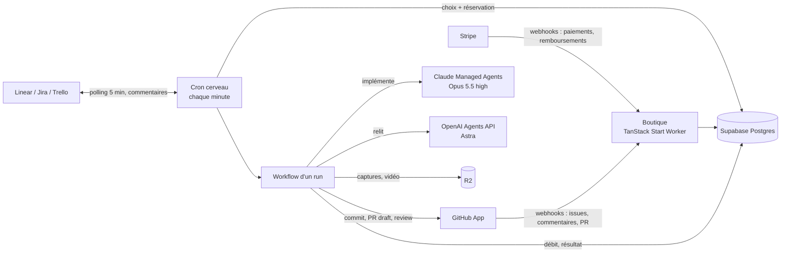
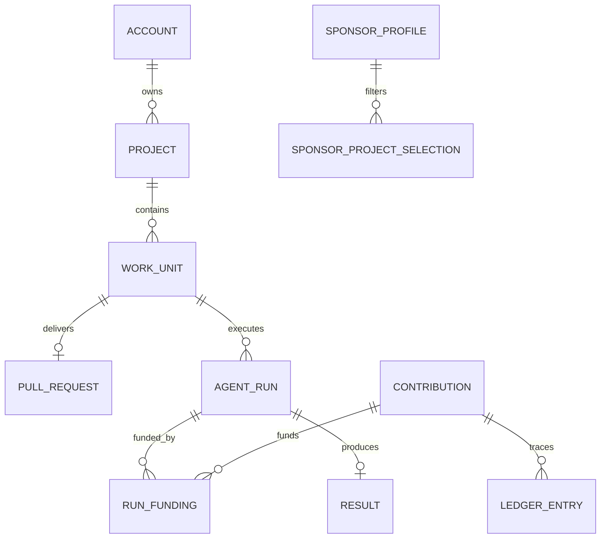

# Architecture

[BUILD.md](mvp/BUILD.md) fait foi pour les décisions. Ce document décrit comment le code les applique.

## Boutique (`wrangler.jsonc`)

- **TanStack Start** sur Cloudflare Workers. Les pages lisent la base via des server functions (`src/functions/`). La base n'est jamais exposée au navigateur.
- **Auth :** Supabase Auth avec GitHub uniquement (`src/server/auth*.server.ts`). Le login GitHub sert aussi à rattacher les installations de la GitHub App au bon compte.
- **Paiements :** Stripe Checkout, puis webhook signé et idempotent. Le crédit n'est écrit qu'à réception du webhook, avec les frais Stripe réels lus dans la balance transaction. Un retour de checkout ne vaut jamais preuve de paiement.
- **GitHub :** le webhook rattache les repos installés, crée ou met à jour les tickets portant le label `agent-commons`, enregistre les demandes de correction `@agent-commons` (membres du repo uniquement) et le merge ou la fermeture des PR.
- **Trackers :** OAuth pour Linear et Jira, jeton utilisateur pour Trello. Les jetons sont chiffrés en AES-GCM (`TOKEN_ENCRYPTION_KEY`).
- **Secrets de test des projets :** écrits directement dans un vault Managed Agents. La base ne garde que leur nom et leur identifiant chez le fournisseur.

## Cerveau (`workers/brain.ts`)

Un Worker avec un cron chaque minute :

1. **Dispatch** (`src/core/queue.ts`) : FIFO dans un compte, tour de rôle entre comptes (le moins récemment servi d'abord), au plus 5 runs en parallèle par compte. Chaque run choisi est réservé dans Postgres, puis un Workflow est créé avec le `runId` comme identifiant.
2. **Reprise** : un run resté en cours sans Workflow vivant est relancé.
3. **Trackers** : toutes les 5 minutes, synchronisation des tickets Linear, Jira et Trello. Un ticket abandonné n'est remis en file que si son contenu change ou s'il est re-tagué.

`DISPATCH=off` coupe la distribution sans interrompre les runs en cours.

## Un run (`AgentWorkWorkflow` + `src/runner/pipeline.ts`)

Chaque étape est un `step` durable : un redémarrage reprend là où il s'était arrêté, sans relancer ce qui est fait.

1. **Préparation :** environnement Managed Agents propre au projet (paquets, commandes de lancement, accès réseau), créé au premier run puis réutilisé. Les secrets de test sont déjà dans le vault du projet.
2. **Implémentation :** une session Claude reçoit le ticket et un jeton GitHub App **en lecture seule**, limité au repo. L'agent écrit ses changements dans un fichier de sortie, avec ses captures et sa vidéo s'il a pu lancer l'app. Il ne pousse jamais.
3. **Ticket flou :** si Claude répond « unclear », Astra relit le ticket. S'il est d'accord, la plateforme commente le ticket avec les questions, et le run se termine en abstention `ticket_unclear`. Sinon, Claude repart avec la lecture d'Astra.
4. **Review :** Astra relit le patch dans sa propre sandbox. Seuls les commentaires `blocking` déclenchent l'unique tour de correction, suivi d'une seconde review.
5. **Livraison :** le cerveau commit via la GitHub App, ouvre la PR draft (ou met à jour la même PR pour une correction) et publie la review finale d'Astra. Il commente aussi le ticket Linear, Jira ou Trello.
6. **Règlement :** le coût réel est débité. Toute erreur termine le run en abstention, avec le coût déjà consommé.

Seul le cerveau écrit sur GitHub. Les sessions ne reçoivent jamais de jeton en écriture.

## Coût d'un run

- **Claude :** Managed Agents donne le coût de la session lui-même (`usage.list_cost`, en cents) : tokens au prix public, recherches web et $0.08 par heure de sandbox.
- **OpenAI :** l'Agents API ne donne que les tokens de chaque tour, pas de montant. Le coût est calculé avec les prix publics d'Astra (`src/runner/openai.ts`), plus le conteneur. Trois écarts mineurs, à la charge de la plateforme : les écritures de cache, les requêtes de plus de 272K tokens et les reviews de plus de 20 minutes.
- **Pas de plafond.** Un run réserve d'abord $10, puis réserve davantage à chaque étape si besoin (`reserveMore`). Si les contributions ne suffisent plus, le reste est enregistré en `uncoveredCents` et absorbé par la plateforme.

## Ledger (`src/db/ledger.ts`)

- **Crédit d'une contribution :** montant HT − frais Stripe réels − 10 % de marge sur le HT (5 % pour les sponsors fondateurs). `available = credit − reserved − debited`, en cents USD.
- **Réservation atomique :** verrou de la work unit puis des contributions éligibles, dans le périmètre du sponsor (`all_except` / `only`, catégories, stacks, projets cachés en opt-in). Un run peut être financé par plusieurs contributions, la plus ancienne d'abord.
- **Idempotence :** chaque écriture a une clé d'idempotence, et un run réglé ne peut pas l'être une seconde fois avec un autre résultat.
- **Événements :** chaque action du ledger écrit un événement dans la même transaction (`run.started`, `run.finished`, `pull_request.merged`…), pour les métriques.
- **Leaderboard :** classé par compute consommé. Crédits promo, remboursements et sponsors anonymes exclus. Le crédit restant est affiché comme « committed ».
- **Accès :** RLS sur toutes les tables, sans policy. Seuls les Workers, via `DATABASE_URL`, lisent et écrivent.

## Références

- [TanStack Start sur Cloudflare](https://developers.cloudflare.com/workers/framework-guides/web-apps/tanstack-start/)
- [Cloudflare Workflows](https://developers.cloudflare.com/workflows/)
- [Claude Managed Agents](https://platform.claude.com/docs/en/managed-agents/overview) et [budgets de session](https://platform.claude.com/docs/en/managed-agents/budgets)
- [OpenAI Agents API](https://developers.openai.com/api/docs/guides/agents-api/overview) et [tarifs](https://developers.openai.com/api/docs/pricing)
